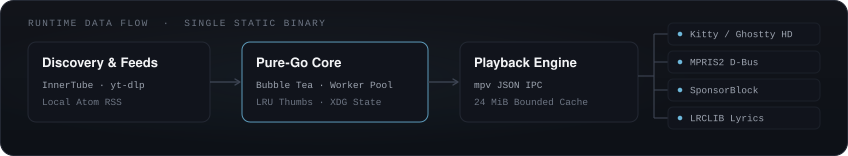

<div align="center">
  <picture>
    <source media="(prefers-color-scheme: dark)" srcset="./assets/banner-dark.svg" />
    <source media="(prefers-color-scheme: light)" srcset="./assets/banner-light.svg" />
    
  </picture>

  <br /><br />

  <a href="#quick-install">Quick Install</a>
  &nbsp;&nbsp;·&nbsp;&nbsp;
  <a href="#architecture">Architecture</a>
  &nbsp;&nbsp;·&nbsp;&nbsp;
  <a href="#capabilities">Capabilities</a>
  &nbsp;&nbsp;·&nbsp;&nbsp;
  <a href="#cli-commands">CLI Commands</a>
  &nbsp;&nbsp;·&nbsp;&nbsp;
  <a href="#requirements">Requirements</a>
</div>

<br />

Search and play YouTube from your terminal. Use Linux media keys to control playback, or download a track and listen offline. `iutui` (`v0.5.3`) is a keyboard-first TUI and CLI built in Go around `mpv` and `yt-dlp`.

## Quick Install

```sh
curl -fsSL https://raw.githubusercontent.com/e12jassir/iutui/main/install.sh | bash
```

Auto-detects Linux/macOS (`amd64`/`arm64`), verifies SHA-256 checksums, and automatically installs missing `mpv` + `yt-dlp` via your package manager (`pacman`/`apt`/`dnf`/`zypper`/`apk`/`brew`; supports `-y`, `--no-deps`, `--uninstall`).

**Prebuilt binaries & packages**

Download `.deb`, `.rpm`, or `.tar.gz` archives for `linux` or `darwin` (`amd64` or `arm64`) from [GitHub Releases](https://github.com/e12jassir/iutui/releases) (`.deb` and `.rpm` declare `mpv` and `yt-dlp` dependencies automatically).

**With Go (`1.27.3+`)**

```sh
go install github.com/e12jassir/iutui/cmd/iutui@latest
```

**From source**

```sh
git clone https://github.com/e12jassir/iutui.git && cd iutui
make install          # builds bin/iutui and installs iutui + uitui to ~/.local/bin
```

Verify runtime dependencies, browser cookie status, and socket paths with:

```sh
iutui doctor
```

## Play your first track

1. Run `iutui`, press `/`, enter a search, and press `Enter`.
2. Highlight a result and press `Enter` to play it. To download a result for offline playback, highlight it and press `d`.
3. If playback does not start, run `iutui doctor` to check dependencies and paths. A first online play can take longer than a cached track because YouTube stream URLs must be resolved before audio can start.

For audio-only playback of a known YouTube URL, use `iutui play -a '<youtube-url>'`.

## Architecture

<div align="center">
  <picture>
    <source media="(prefers-color-scheme: dark)" srcset="./assets/architecture-dark.svg" />
    <source media="(prefers-color-scheme: light)" srcset="./assets/architecture-light.svg" />
    
  </picture>
</div>

<br />

Single-video playback resolves through a cookieless `player_client=android` path paired with asynchronous lookahead prefetching. The UI runs inside a single static Go binary built with Bubble Tea and Lip Gloss, keeping the `mpv` demuxer cache bounded to `24 MiB` and leaving zero Python or Node runtime processes behind.

## Capabilities

| Area | Behavior |
|---|---|
| **Playback & Prefetch** | Fast `player_client=android;player_skip=webpage,configs` stream resolution paired with coalesced priority lookups, live `mpv` playlist CDN hot-swapping on track transitions, and smooth `volume-gain` audio fades. |
| **Linux MPRIS2 D-Bus** | Exports track metadata, artist, cover art, position, playback rate, and transport controls over `org.mpris.MediaPlayer2.iutui` for `playerctl`, lock screens, and media keys. |
| **Live Queue & Autocomplete** | Inspect and edit the active `mpv` queue with `u`; search with `/` using cursor-based editing, persisted search history, and live YouTube suggestions (`Tab` to complete). |
| **Speed, Loop & Auto-Resume** | Adjust playback rate from `0.5x` to `2.0x` (`{` / `}` / `0`), toggle single-track repeat (`R`), and resume watched videos automatically via `resume.json` with IPC `start=` reuse. |
| **Offline Downloads & Feeds** | Background downloads (`d`) show percentage, speed, and ETA, and play directly from disk when opened offline. Sync the **Music** tab with authenticated YouTube Music (`FEmusic_home` via browser cookies) blended with smart local curation, and manage Watch Later (`w`), Liked (`W`), and local RSS subscriptions (`s`, including `@handles`) with no account. |
| **SponsorBlock, Lyrics & Data Saver** | Skip sponsor segments via `B`, view 3-layer synced lyrics and YouTube captions (`L` — pure-Go YouTube InnerTube `captionTracks` + duration-aware `LRCLIB`, live sync adjustment `z`/`Z`/`Y`, source toggle `y`), toggle `mpv` subtitles (`C`) or Picture-in-Picture (`P`), jump chapters (`o`), cycle presets (`f` / `c`), or switch live between video and audio-only (`V` / `x`). |
| **Themes, i18n, Settings & Diagnostics** | Bilingual `es`/`en` UI (`YT_LANG`), 18 live settings in Settings Studio (`S`), 6 built-in themes (`youtube-dark`, `catppuccin`, `tokyonight`, `gruvbox`, `kanagawa`, `terminal` via `t`), `NO_COLOR` support, and JSON `slog` traces via `--debug-log`. |

## Requirements

| Dependency | Status | Purpose |
|---|---|---|
| [`mpv`](https://mpv.io/) | Required | Hardware-accelerated playback and JSON IPC transport |
| [`yt-dlp`](https://github.com/yt-dlp/yt-dlp) | Required | Stream resolution, metadata, search, and background downloads (`yt-dlp -U` to update) |
| `deno` / `node` / `bun` | Optional | JS runtime for `yt-dlp` web extractor fallbacks |
| Kitty / Ghostty or truecolor terminal | Built-in | Native pure-Go thumbnails: HD Kitty pixel graphics in Kitty/Ghostty and 24-bit ANSI quadrant blocks elsewhere (no `chafa` required) |
| `playerctl` / D-Bus | Optional | Linux hardware media keys and MPRIS2 integration |
| `wl-copy` / `xclip` / `pbcopy` | Optional | Clipboard support on Wayland, X11, or macOS |

## CLI Commands

| Command | Description |
|---|---|
| `iutui` | Launch the interactive TUI |
| `iutui --debug-log` | Enable JSON `slog` diagnostics in `$XDG_STATE_HOME/iutui/debug.log` (`0600`) |
| `iutui --version` | Print installed version (`iutui version 0.5.3`) |
| `iutui -q` (`--quick`) | Open the interactive quick selector |
| `iutui play [-a\|-m\|--pip\|--fs] <id\|url>` | Play a video or URL directly (`-a` audio, `-m` Mix Radio, `--pip`, `--fs`) |
| `iutui status [--json\|--waybar]` | Print live `mpv` playback state (`plain`, `--json`, or `--waybar`) |
| `iutui seek <seconds>` | Seek relative seconds in the active `mpv` instance (for example `-10`, `30`) |
| `iutui pause\|next\|prev` | Toggle pause or skip tracks via `mpv` IPC |
| `iutui subscribe <id\|handle\|url>` | Subscribe to a channel via local RSS |
| `iutui channels` | List subscribed channels |
| `iutui queue` | Show background and completed downloads |
| `iutui doctor` | Verify dependencies (with install hints), check browser cookie status, and print resolved XDG and socket paths |

---

<details>
<summary><strong>Keybindings</strong></summary>

Mouse clicks and scrolling work across cards, sidebar tabs, overlays, and the player bar.

| Key | Action | Key | Action |
|---|---|---|---|
| `j` / `k` / `h` / `l` / Arrows | Navigate grid, list, or sidebar | `w` | Save or remove in Watch Later |
| `Enter` | Play (`auto` mode) | `W` | Like or unlike video (`liked.tsv`) |
| `a` / `v` | Play audio-only or video window | `s` | Subscribe or unsubscribe channel (RSS) |
| `V` / `x` | Toggle live video or audio mode | `g` / `G` | Open highlighted video's channel |
| `m` | Play YouTube Mix Radio | `q` | Enqueue video to `mpv` playlist |
| `Space` | Pause or resume playback | `u` | Open Live Queue overlay |
| `n` / `p` | Next or previous item in queue | `d` | Download video in background |
| `,` / `.` (`<` / `>`) | Seek `-10s` / `+10s` | `o` | Open interactive chapters overlay |
| `-` / `+` (`=`) | Volume `-5%` / `+5%` | `C` / `P` | Toggle `mpv` CC subtitles / Picture-in-Picture |
| `l` / `L` | Toggle synced lyrics / YouTube captions | `O` / `Ctrl+O` | Open video in default browser |
| `z` / `Z` / `Y` | Shift lyrics sync `-0.5s` / `+0.5s` / reset | `y` | Copy video URL (or switch lyrics source when `L` open) |
| `{` / `}` / `0` | Speed `-0.25x` / `+0.25x` / `1.0x` | `b` / `B` | Toggle SponsorBlock skipping |
| `R` | Toggle single-track loop | `t` / `T` | Cycle color theme |
| `/` (`Tab` / `↓` / `↑`) | Focus search and cycle suggestions | `f` / `F` | Open Quality & Audio-Only modal |
| `[` / `]` | Cycle local filter chips | `c` | Cycle quality (`MAX`/`1080p`/`720p`/`480p`/`360p`/Audio) |
| `1`..`5` | Quick-switch main tabs | `A` | Toggle continuous Autoplay |
| `Tab` | Switch focus between view and sidebar | `r` | Force refresh current view |
| `S` | Toggle Settings Studio (18 live settings) | `?` | Open help overlay |
| `Esc` | Close overlay or return focus | `Q` | Quit `iutui` |

</details>

<details>
<summary><strong>Data Usage Reference</strong></summary>

| Quality Preset | Approximate Usage | Notes |
|---|---|---|
| `4K` (`MAX` / `2160p`) | `~15 GB/h` | Maximum resolution when available |
| `1080p` Full HD | `~2.5 GB/h` | High definition |
| `720p` HD *(default)* | `~1.0–1.2 GB/h` | Default balance between clarity and bandwidth |
| `360p` Data Saver | `~250–300 MB/h` | Low-bandwidth preset via `f` or `c` |
| Audio-only (`a` / `V` / `x`) | `~50–55 MB/h` | Music, podcasts, and background listening |

</details>

<details>
<summary><strong>XDG Paths &amp; Legacy Migration</strong></summary>

| Purpose | Default Path | Override Env Var |
|---|---|---|
| Configuration (`config`) | `~/.config/iutui` | `$XDG_CONFIG_HOME/iutui` |
| Cache & thumbnails (`feed_*.json`, `video_meta.json`, `cookies.txt`, `cookies.stamp`, `lyrics_offsets.json`) | `~/.cache/iutui` | `$XDG_CACHE_HOME/iutui` |
| State (`subscriptions.tsv`, `watchlater.tsv`, `liked.tsv`, `history.tsv`, `resume.json`, `search_history.tsv`, `downloads/`, `debug.log`) | `~/.local/state/iutui` | `$XDG_STATE_HOME/iutui` |
| Runtime `mpv` IPC socket | `$XDG_RUNTIME_DIR/iutui/mpv.sock` | Falls back to `/tmp/iutui-<uid>/mpv.sock` |

On first launch, `iutui` performs a one-time copy of subscriptions, watch-later lists, history, download records, and config from legacy `ytx` and `yt` directories (`~/.config/yt`, `~/.cache/yt_terminal`, `~/.local/state/yt`, and `ytx` XDG folders). Existing files remain untouched and browser cookie jars are skipped.

</details>

<details>
<summary><strong>Configuration &amp; Privacy Isolation</strong></summary>

`iutui` reads plain `KEY=value` pairs from `~/.config/iutui/config` (never executed as shell code). Environment variables take precedence. See [`config.example`](config.example) for the complete annotated template.

```ini
YT_QUALITY=720
YT_SPONSORBLOCK=1
YT_THEME=youtube-dark       # youtube-dark | catppuccin | tokyonight | gruvbox | kanagawa | terminal
YT_DEFAULT_MODE=window      # window | pip | fs | audio
YT_COOKIES=auto             # auto | off (guest mode: search + local RSS)
```

When authenticated feeds are enabled (`YT_COOKIES=auto`), browser cookies are read at most once per `YT_COOKIE_TTL` (6 hours by default), filtered strictly to Google/YouTube domains, and written with `0600` permissions. Set `YT_COOKIES=off` for pure guest mode.

</details>

<details>
<summary><strong>Development &amp; Verification</strong></summary>

```sh
make build   # compile pure-Go binary to bin/iutui
make lint    # verify gofmt cleanliness and run go vet ./...
make test    # run go test -race ./...
make verify  # run lint + full race test suite
```

Cross-compile targets:

```sh
CGO_ENABLED=0 GOOS=darwin  GOARCH=arm64 go build -o /dev/null ./cmd/iutui
CGO_ENABLED=0 GOOS=linux   GOARCH=arm64 go build -o /dev/null ./cmd/iutui
CGO_ENABLED=0 GOOS=windows GOARCH=amd64 go build -o /dev/null ./cmd/iutui
```

</details>

<br />

<p align="center">
  <sub>MIT License &nbsp;·&nbsp; <a href="https://github.com/e12jassir">Esteban Marrugo</a></sub>
</p>
